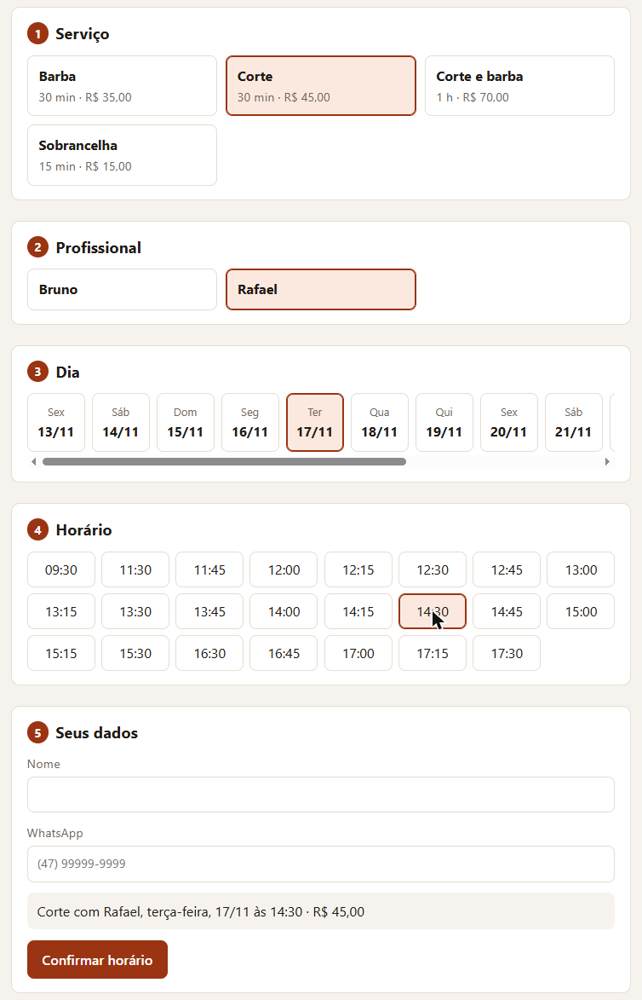
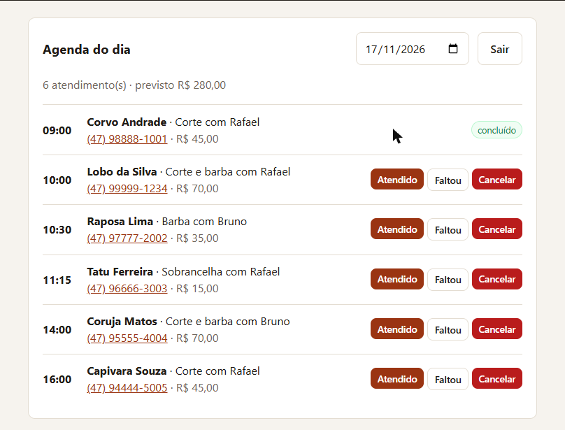

# Agenda online (front-end)

Site de agendamento para uma barbearia, em **React + TypeScript**, que consome a
[Agenda API](https://github.com/edudiasr/agenda-api) (Java + Spring Boot).

<table>
  <tr>
    <td></td>
    <td></td>
  </tr>
</table>

## Telas

- **Agendar**: o cliente escolhe serviço, profissional, dia e horário livre, informa nome e
  WhatsApp e recebe um código.
- **Meu horário**: com o código, o cliente consulta e cancela.
- **Barbearia**: o dono entra com e-mail e senha e vê a agenda do dia, com o total previsto,
  o WhatsApp de cada cliente (link direto) e os botões de atendido, faltou e cancelar.

## Detalhes que cuidei

- **Cada escolha limpa as que dependem dela.** Trocar o serviço muda a duração, então os
  horários livres mudam: o horário escolhido é descartado e a lista é buscada de novo.
- **Horário que acabou de ser ocupado.** Se outra pessoa marcou o mesmo horário segundos antes,
  a API responde 409. A tela mostra o aviso e recarrega a lista de horários sozinha.
- **Erros por campo.** Quando a API recusa um campo (telefone em formato errado, por exemplo), a
  mensagem aparece embaixo dele. Ela fica ligada ao campo por `aria-describedby`, então o leitor
  de tela anuncia o erro junto com o nome do campo.
- **Servidor dormindo.** No plano gratuito do Render a API "dorme" quando ninguém usa, e a
  primeira chamada demora. Se uma resposta passa de 4 segundos, aparece um aviso explicando.
- **Token só na sessão.** O token do dono fica no `sessionStorage` e some ao fechar a aba, para
  um computador compartilhado da recepção não ficar com o painel aberto. Se o token vence, a API
  responde 401 e a tela volta para o login.
- **Rotas pelo `#`** (`#/admin`, `#/meu-horario`): o GitHub Pages só serve arquivos e não sabe
  mandar `/admin` para o `index.html`.

## Testes

11 testes com Vitest e Testing Library. O `fetch` é substituído por uma API falsa que responde
cada rota, e os testes clicam e digitam como o usuário:

- marcar do início ao fim e conferir o que foi enviado para a API
- trocar o serviço no meio limpa o horário e busca de novo
- 409: aviso na tela e lista de horários atualizada
- erro de validação aparece no campo certo e como descrição acessível
- consultar e cancelar pelo código
- login guarda o token, manda nas chamadas e soma o previsto sem os cancelados
- token vencido volta para o login
- aviso de servidor acordando

```bash
npm test
```

## Rodando

```bash
npm install
npm run dev        # http://localhost:5174, usando a API em http://localhost:8080
```

Para apontar para outra API: `VITE_API_URL=https://... npm run build`.

## Licença

MIT
